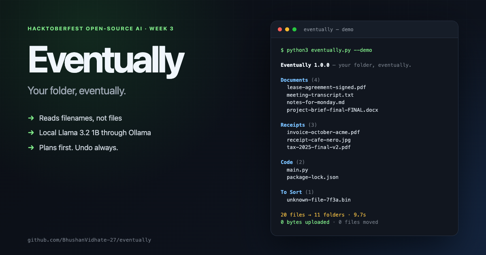

# Eventually

**Your folder, eventually.**



[](https://github.com/BhushanVidhate-27/eventually/actions/workflows/tests.yml)

Eventually is a tiny local-first CLI that tidies a messy folder without opening a single file. It reads only filenames, asks a local open-weight model where each thing belongs, prints a plan, and moves nothing until you pass `--apply`. Every move is logged, and `--undo` puts it all back.

Built for **[Hacktoberfest Open-Source AI Challenge Week 3: Slow and Steady](https://dev.to/challenges/hacktoberfest-week3-2026-10-19)**. The chore it automates: the Downloads folder.

```text
20 files (827 B) → 11 folders · 9.7s · 0 bytes uploaded · 0 files moved.
```

No API keys. No cloud. No file contents. No pip install.

---

## Why this exists

My Downloads folder is a waiting room. `lease-agreement-signed.pdf` sits next to `Figma.dmg` and `voice-note-mom.m4a`. Every time I open it, I make the same tiny decision twenty times, then close the window and promise to deal with it later.

Eventually deals with it later, on purpose. It is not a file manager and it does not watch anything. You point it at one folder, it prints a calm plan, and it waits for you to say yes.

## What it does

- Reads **filenames only**. Never file contents, never metadata beyond the name and size.
- Asks a **local open-weight model** (Llama 3.2 1B through Ollama by default) to choose one of 11 folders.
- Prints the plan **before touching anything**. `--apply` is a separate, explicit step.
- Uses a few small guardrails for obvious cases (`.py` is Code, `.dmg` is an Installer, a photo of a receipt is a Receipt).
- Never overwrites: a collision becomes `report (2).pdf`.
- Writes an undo manifest to `~/.eventually/last-run.json`.
- Skips hidden files, folders, symlinks, and in-progress downloads (`.crdownload`, `.part`, `.tmp`).
- Leaves unsure files in **To Sort** instead of guessing.
- Runs offline after the model is pulled. Nothing leaves the machine.

## Requirements

- macOS or Linux
- Python 3.10+ (standard library only)
- [Ollama](https://ollama.com/) running locally
- One small open-weight model:

```bash
ollama pull llama3.2:1b      # 1.3 GB, the default floor
# optional, better judgment if you already have it:
# ollama pull qwen2.5:3b
# ollama pull llama3.2:3b
```

Eventually auto-detects `qwen2.5:3b`, `llama3.2:3b`, `llama3.2:1b`, `gemma2:2b`, or `phi3:mini`, in that order. You can also pass `--model`.

## Quick start

```bash
# 1. Start the local model server (once per session)
ollama serve

# 2. Pull a small model (once)
ollama pull llama3.2:1b

# 3. Clone and try it on a disposable demo folder
git clone https://github.com/BhushanVidhate-27/eventually.git
cd eventually
python3 eventually.py --demo
```

`--demo` creates `./demo-downloads` with 20 realistic filenames and plans a tidy. Nothing moves.

```bash
# 4. Move them, then undo if you want
python3 eventually.py demo-downloads --apply
python3 eventually.py --undo
```

For the real thing:

```bash
python3 eventually.py ~/Downloads
python3 eventually.py ~/Downloads --apply
python3 eventually.py --undo
```

One command to see the plan. One flag to commit. One command to take it back.

## The three commands that matter

```bash
# Look. This is the default. It never moves anything.
python3 eventually.py ~/Downloads

# Move. A manifest is written first, so the move is reversible.
python3 eventually.py ~/Downloads --apply

# Undo the most recent apply.
python3 eventually.py --undo
```

Useful extras:

```bash
python3 eventually.py --demo --explain   # show the model's one-line reason per file
python3 eventually.py ~/Downloads --model qwen2.5:3b
python3 eventually.py --help
```

## Safety rules

Eventually is deliberately conservative:

1. **Dry-run by default.** The only way to move a file is `--apply`.
2. **One folder, top level only.** It does not recurse into subfolders.
3. **No symlinks, no hidden files, no in-progress downloads.**
4. **No overwrites.** Existing files are kept; the new file gets a ` (2)` suffix.
5. **Fail closed.** If the model errors on a file, that file goes to `To Sort`, not to a guessed folder.
6. **Undo is a first-class command.** The manifest records every move and every directory Eventually created.
7. **No network calls except `localhost:11434`.** There is no telemetry and no API key.

## How it works

```text
folder
  │
  ├─ list top-level filenames (names and sizes only)
  │
  ├─ for each name: POST /api/chat to local Ollama
  │     system prompt: 11 folders + examples + "use To Sort if unsure"
  │     JSON schema:   { folder, confidence, why }
  │
  ├─ guardrails: catch obvious extension mistakes
  │
  ├─ print plan, grouped by folder
  │
  └─ --apply → create folders → move with collision-safe names
                → write ~/.eventually/last-run.json
                → --undo replays the manifest in reverse
```

The model is the decision-maker for ambiguous names: is `lease-agreement-signed.pdf` a Document or a Receipt? Is `IMG_4821.HEIC` a photo or a screenshot? The guardrails only cover cases where a 1B model should not be trusted with an obvious extension.

The first version sent all filenames in one prompt. The 1B model looped and repeated names. One filename per request was slower and much more reliable: twenty small decisions, about half a second each, four requests in flight. Slow and steady was also the better engineering choice.

## Tests

No model required. The test suite uses a fake classifier and a temporary folder.

```bash
python3 -m unittest discover -s tests -v
```

21 tests cover JSON parsing, folder normalization, guardrails, file discovery, collision-safe naming, apply, undo, model failure, and the demo fixture.

## Demo

The full 60–90 second recording script is in [DEMO.md](DEMO.md). It needs no hosted server: it runs against local Ollama and uses the generated `demo-downloads` folder.

Three beats:

1. **Plan** — 20 messy names, 11 folders, 9.7 seconds, `0 bytes uploaded · 0 files moved`.
2. **Apply** — the same 20 files land in `Documents/`, `Receipts/`, `Code/`, and friends. No overwrites.
3. **Undo** — all 20 files come back to the top level. The folder is messy again, on purpose.

## The lazy payoff

Measured on this machine (Apple M2, macOS 27.0.1, `llama3.2:1b` already loaded):

| | |
|---|---|
| Files in the demo | 20 |
| Eventually, dry run | **9.7 seconds** |
| My manual baseline (estimate) | **4 minutes** |
| Net saving per weekly tidy | **~3.8 minutes** |
| Over a year | **~3.3 hours** |

The estimate is deliberately conservative. It is mostly decision time, not dragging time: opening each file name, deciding whether a receipt is a Document or a Receipt, and then doing it again next week. Eventually makes those decisions in one pass and asks me once.

The bigger payoff is the open loop closing. I no longer have a folder that asks me a question every time I open Finder.

## Why local open weights

The filenames are the argument. A filing tool sees `lease-agreement-signed.pdf`, `invoice-october-acme.pdf`, `tax-2025-final-v2.pdf`, and `voice-note-mom.m4a`. That is exactly the metadata I do not want to upload to a closed API just to avoid opening Finder.

A 1.3 GB model on my disk makes the private version the default. It works on a plane. It does not need a key, a credit card, or a vendor's permission. And because the harness is open source, you can read every line and confirm that only names go to `localhost:11434`.

## Contest window

This is a brand-new project. The first commit was made on **25 October 2026**, and every commit in this repository was made inside the Hacktoberfest Open-Source AI Challenge Week 3 window (**19–25 October 2026**). No commits were made after the deadline. If a commit is added after submission, it will be noted here.

## License

MIT. See [LICENSE](LICENSE).
